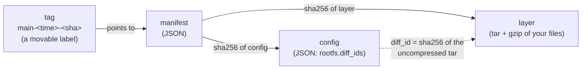
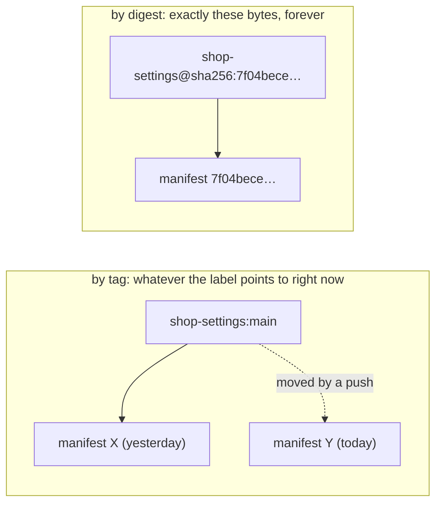
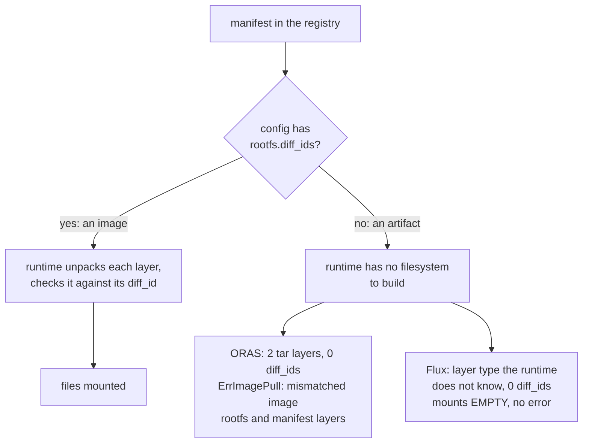
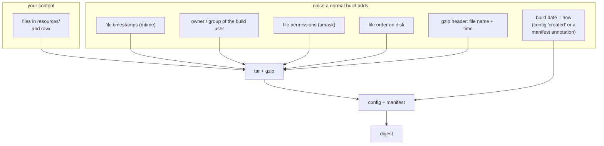
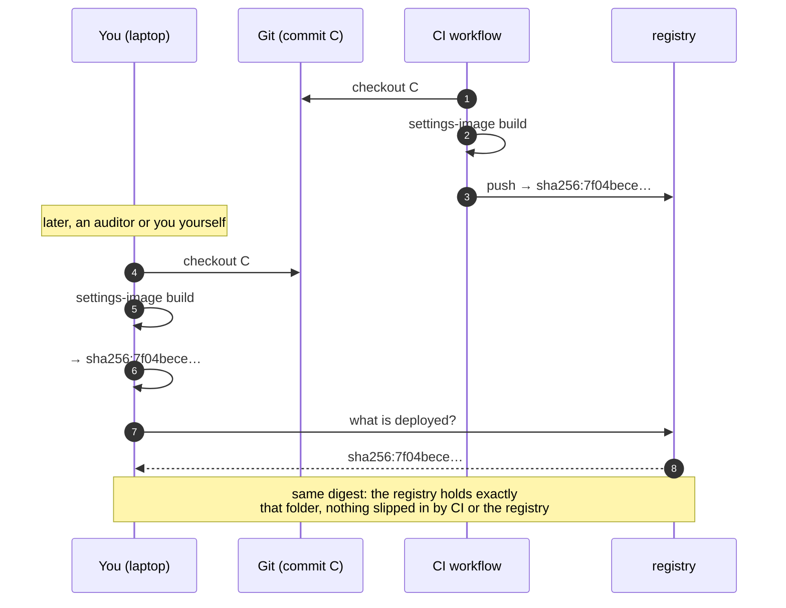
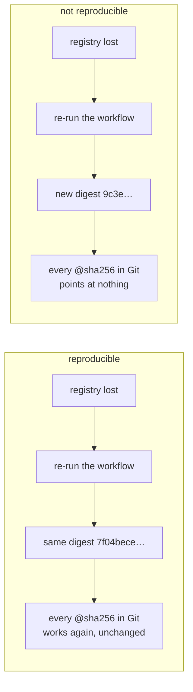
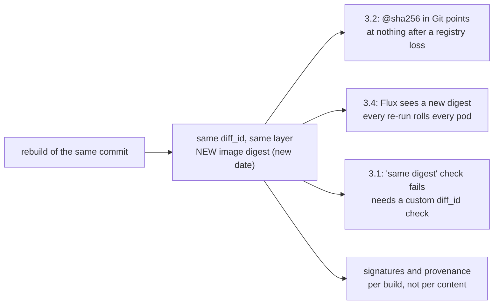
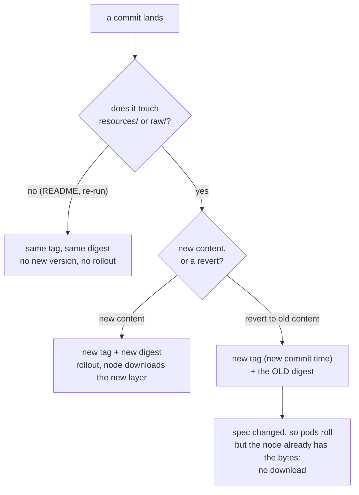
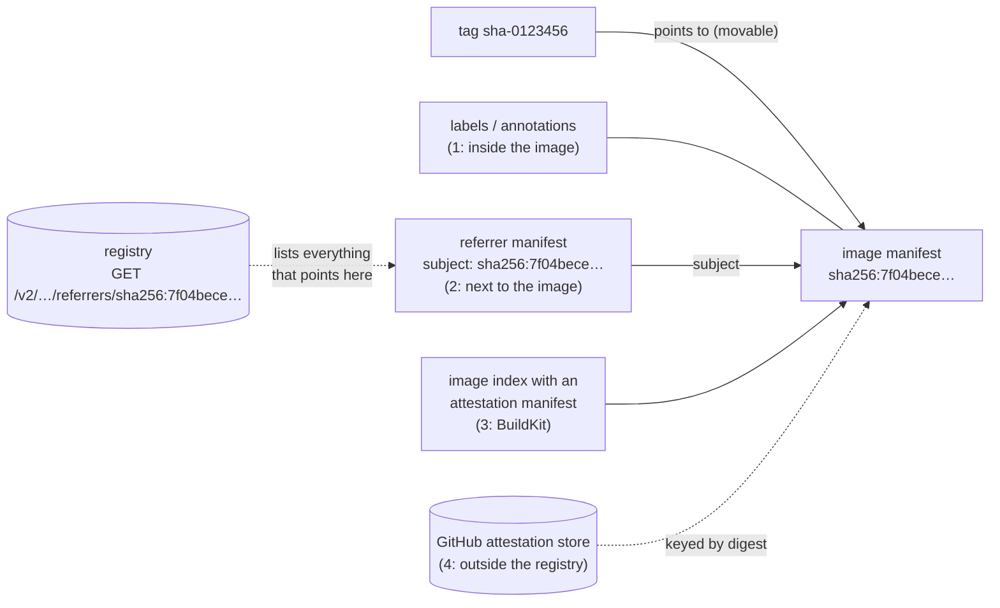

# Images, digests and provenance

_How an OCI image is put together, why settings-image works hard to give **the same digest for
the same files**, what that buys, and where provenance fits. Numbers are from
[examples/custom-resources](../examples/custom-resources), built with settings-image v0.2.1 and
`--no-provenance` on 2026-11-03: digest `sha256:7f04bece…`, the same as in
[compare/](../compare/README.md)._

The exact bytes are in [format-v2.md](format-v2.md). This page explains why they look the way they
do.

## 1. What an image actually is

An image in a registry is three small kinds of blobs that point at each other **by hash**:



- The **layer** is a tarball of your files.
- The **config** describes the image. It lists `rootfs.diff_ids`, the hash of each layer before
  compression; containerd checks those when it unpacks. A normal image config also has `created`,
  labels, an entrypoint; settings-image's has none of those.
- The **manifest** lists the config and the layers, each by its sha256, plus annotations.
- The **image digest** is the sha256 of the manifest.

The hashes are nested, like a Merkle tree. Change one byte in one file and the layer hash changes,
so the config and the manifest change, so the digest changes. **The digest is a fingerprint of
everything in the image.**

A **tag** is a label that points to a manifest, and it can be moved. A **digest** cannot be moved:
it _is_ the content.



That is why settings are mounted **by digest**. A tag is re-resolved at each container start: with
`pullPolicy: Always`, a crash restart picked up new content inside a running pod, and two replicas
served different values (**verified**, [background.md §3](background.md#3-facts-the-format-depends-on)).

### 1.1 Image or artifact?

Both live in a registry, behind the same kind of manifest, and both have a digest. To a registry,
everything is blobs pointing at blobs by hash. The difference is **who is meant to read it**, and
that is written in the **config**:

- An **image** is meant for a **container runtime** (containerd, CRI-O). Its config says "this is a
  filesystem: unpack these layers, in this order, and check each one against this hash"
  (`rootfs.diff_ids`).
- An **artifact** is meant for **the tool that wrote it**: Helm reads a chart, Flux its source,
  cosign a signature. Its config is empty (`{}`) or the tool's own type, an `artifactType` may say
  what it is, and its layers can be any bytes.

The same folder, three ways ([compare/](../compare/README.md)), trimmed to what matters:

```jsonc
// settings-image: an IMAGE
"config": { "mediaType": "application/vnd.oci.image.config.v1+json" },
"layers": [ { "mediaType": "application/vnd.oci.image.layer.v1.tar+gzip" } ]
// the config itself:
{ "architecture": "amd64", "os": "linux",
  "rootfs": { "type": "layers", "diff_ids": [ "sha256:6e19a3cc…" ] } }

// oras push resources raw: an ARTIFACT
"artifactType": "application/vnd.unknown.artifact.v1",
"config": { "mediaType": "application/vnd.oci.empty.v1+json" },          // the config is {}
"layers": [ { "mediaType": "application/vnd.oci.image.layer.v1.tar+gzip" },  // resources
            { "mediaType": "application/vnd.oci.image.layer.v1.tar+gzip" } ]  // raw

// flux push artifact: an ARTIFACT
"config": { "mediaType": "application/vnd.cncf.flux.config.v1+json" },
"layers": [ { "mediaType": "application/vnd.cncf.flux.content.v1.tar+gzip" } ]
// the config itself: os "", architecture "", "diff_ids": null
```

All three are gzipped tarballs of your files, and ORAS's layers even have the normal image layer
type. What ORAS and Flux lack is the image config: nothing tells the runtime which layers make up
a filesystem, and with which hashes.



That fits both failures measured on k3s ([alternatives.md §2](alternatives.md#2-what-each-tool-produces-and-what-mounts)).
ORAS has two layers containerd unpacks and zero `diff_ids` to check them against, so the counts
disagree and the pull fails. Flux's one layer has a media type containerd does not treat as a
filesystem layer; zero layers and zero `diff_ids` agree, and you get an empty filesystem. (That
reading fits both observations; it was not traced in containerd's source.)

**Neither shape is better.** An artifact is right for a Helm chart, a signature or an SBOM, because
nothing should unpack those: settings-image's own provenance is an artifact (§5). An **image
volume** asks the runtime to unpack, so settings must be an image. (CRI-O can also mount artifacts,
**not tested**; containerd cannot. An image works on both.)

To check any reference yourself:

```bash
crane manifest <ref> | jq '{artifactType, config: .config.mediaType, layers: [.layers[].mediaType]}'
crane config <ref> | jq .rootfs        # an image has diff_ids, one per layer
```

## 2. Why the same files don't give the same digest by default

A digest hashes **bytes**, not "the files". A normal build mixes in things that are not your
files:



Every noise box changes from build to build, so the digest does too, even when not a single
setting changed. settings-image **pins all of them** ([format-v2.md §6–7](format-v2.md#6-the-layer)):

| Noise | What settings-image does |
|---|---|
| file order | sorted by path, every parent directory as an explicit entry |
| timestamps | every entry at the Unix epoch (1 January 1970) |
| owner | uid/gid 0, no user or group names |
| permissions | files `0644`, directories `0755` (also stops a committed script from being executable in the pod) |
| gzip | Go's `compress/gzip` at `BestCompression`, empty header: no name, no time |
| build date | the config has **no** `created` field; the manifest annotation `org.opencontainers.image.created` is pinned to the epoch (oras-go would otherwise stamp _now_): the "1970" you see |

What is left is only what is in `resources/` and `raw/`, plus the `--source` URL that is recorded
in the manifest. The same folder built with `--source https://github.com/ConfigButler/settings-image`
gives `sha256:464ec405…` instead of `7f04bece…`: build with the same `--source`, or none, to compare.

> **The 1970 date is the price.** The real time is in the timestamp tag
> (`main-<commit time>-<sha>`), in the provenance referrer and in Git, which is where it belongs.

### 2.1 One small change: is everything different?

Yes, all four hashes. The example built twice, the second time with one line added to
`resources/flavours/seasonal/pumpkin.yaml`:

| Hash | as is | one line added |
|---|---|---|
| diff_id (uncompressed tar) | `6e19a3cc…` | `b54aff46…` |
| layer (gzipped tar) | `d65fc6c4…`, 674 bytes | `0e8aba55…`, 682 bytes |
| config (lists the diff_id) | `c3434d35…` | `39eefe68…` |
| **manifest = image digest** | **`7f04bece…`** | **`1008a69d…`** |

That is the Merkle tree from §1: the change goes up through every level. There is also nothing to
share between the two versions, because settings-image puts **all** files in **one** layer. A
Docker image with many layers reuses the unchanged ones. Here the whole layer is new, but it is a
few hundred bytes, so that costs nothing.

### 2.2 Which noise lands in which hash

Not every kind of noise reaches the same level, and that explains which noise has to be zeroed:

| Noise | diff_id | layer digest | config | image digest |
|---|---|---|---|---|
| mtime, permissions, owner, file order | changes | changes | changes | changes |
| gzip header (name, time) | – | changes | – | changes |
| build date (manifest annotation) | – | – | – | changes |
| build date (config `created`, other tools) | – | – | changes | changes |

The first row is the real trouble: those things are **inside the tar**, in the header of every
file, so they change the hash of the content itself. The build date is not part of the content. It
only sits in the outer levels. That raises an obvious question, answered in §3.5.

## 3. Why that is worth it, in order of importance

### 3.1 The image can be checked

Without reproducibility, "built from commit X" is a claim you have to trust. With it, anyone can
check it:



### 3.2 References in Git survive losing the registry

With Flux image automation ([flux.md](flux.md)), Git holds `shop-settings:main-…@sha256:7f04bece…`.
Suppose the registry's storage is lost:



### 3.3 The digest is the same in every registry

Push the same folder to two registries and both hold the same digest. You can mirror, fail over or
move registries, and `@sha256:7f04bece…` still means the same thing. A signature on that digest is
valid wherever the image lives. (A copy with `crane copy` or `oras copy` keeps the digest of any
image; reproducibility means two independent _builds_ agree too.)

### 3.4 A re-run changes nothing

A re-run, or a commit that only touches the README, reports `changed: false` and creates no new
version ([cli.md](cli.md)). The registry's history lists only real changes to the settings.

### 3.5 Couldn't we keep the real date, and compare a deeper hash?

The idea: put the real build or push date in the image, so every build is a **new image**, and
check that the **content** is equal by comparing a hash further down, the layer or its diff_id.
Those don't change with the date (§2.2).

**Technically, that works.** The example with `2026-11-03T09:00:00Z` in the manifest annotation
instead of 1970 (manifest edited by hand, digests computed, not pushed):

| Hash | date 1970 | real date |
|---|---|---|
| diff_id | `6e19a3cc…` | `6e19a3cc…` same |
| layer | `d65fc6c4…` | `d65fc6c4…` same |
| image digest | `7f04bece…` | `8f1be012…` **different** |

So "new image, same content" is a real thing, and you can prove it:

```bash
crane config <ref-a> | jq -r '.rootfs.diff_ids[]'   # equal diff_ids = equal files
crane config <ref-b> | jq -r '.rootfs.diff_ids[]'
```

Compare the **diff_id**, not the layer digest: it hashes the uncompressed tar, so a different gzip
library or level leaves it unchanged. The mtime and permissions still have to be zeroed, though,
because they are in that tar.

**Why settings-image still doesn't do it:** nothing in the chain looks at the layer. Kubernetes,
Flux, cosign and the registry all work with the **image digest**, the hash of the manifest. With a
date in it:



Each of those can be fixed with tooling that compares diff_ids instead. But then every consumer
needs that tooling, and the one standard handle everyone already uses (`@sha256:…`) no longer means
"these files". Removing the date costs nothing and keeps that handle meaning the content.

**And the push date in particular?** It is not a fact about the content, but about **one
registry**: the same image copied to another registry a week later has a different push date
there. That is why it can't go in the bytes, and why registries record it themselves (ghcr.io
shows "published"). The times that _are_ about the settings live outside the image: the commit
time, in the timestamp tag and in the provenance referrer (§5).

## 4. And restarts?

Fewer restarts is a side effect, not the goal. A pod restarts when its **spec** changes, here the
image reference (tag + digest).



## 5. Provenance

**Provenance** is a statement about one digest: "`sha256:7f04bece…` was built from repository R,
commit C, by builder B". Three questions decide how much it is worth:

1. **What does it say?** Commit, source, builder, inputs.
2. **Where does it live?** In the image, next to it, or somewhere else.
3. **Who vouches for it?** Nobody (a claim), or a signature you can check (an attestation).

### 5.1 A tag is not provenance

A tag is a name that points at a digest. `sha-0123456` _suggests_ a commit, but:

- anyone who can push can point it at any digest. It records a choice, not a fact.
- it points the wrong way. From the tag you find the image, but from a digest (what the pod
  runs) you can't find its tags without listing every tag in the repository.
- it says nothing about who built the image, or how.

The `sha-` tag is a **lookup**: "give me the image for commit 0123456". Useful, but the provenance
is the referrer next to it.

### 5.2 The four usual places



**1. Inside the image: labels and annotations.** `LABEL org.opencontainers.image.revision=…` in a
Dockerfile goes into the config; `docker/metadata-action` writes the same keys as labels and
manifest annotations; `flux push artifact` records `--source` and `--revision` as annotations. They
travel with the image, but they are part of the digest: put the commit in them and every commit
gets a new digest, even when the files did not change. That is why settings-image puts only the
source URL there (constant per repository). They are also unsigned.

**2. Next to the image: a referrer** (OCI 1.1, 2024). A referrer is an ordinary manifest, usually
an artifact, with one extra field:

```jsonc
{ "artifactType": "application/vnd.configbutler.settings-image.provenance.v1+json",
  "subject": { "mediaType": "application/vnd.oci.image.manifest.v1+json",
               "digest": "sha256:7f04bece…" },          // ← "I am about that image"
  "layers": [ { /* the provenance JSON */ } ] }
```

Because it is a separate manifest, the image's digest does not change. You can attach referrers
later, and as many as you like: signatures, SBOMs, scan results, provenance. The arrow points from
the referrer to the image, and the registry keeps the reverse index:
`GET /v2/<repo>/referrers/<digest>` lists everything pointing at a digest, filterable by
`artifactType`. A registry without that API (ghcr.io) gets a fallback: an index under the tag
`sha256-<hex of the digest>`, which the client maintains ([format-v2.md §9](format-v2.md#9-provenance-a-referrer-not-part-of-the-image)).
Notation and `oras attach` store signatures and SBOMs this way; cosign used its own
`sha256-<hex>.sig` and `.att` tags, and newer versions can use referrers. Read them with:

```bash
oras discover <registry>/shop-settings@sha256:7f04bece…   # the tree of referrers
```

**3. In an image index: BuildKit attestations.** `docker buildx build` attaches a provenance
attestation **by default** when it pushes (mode `min`; `--provenance=mode=max` records more,
`--sbom=true` adds an SBOM). It wraps the image in an index and puts the attestation next to it as
a manifest with platform `unknown/unknown`. The top-level digest then belongs to the index, and
because the attestation records the build, that digest changes on every build: one reason the
`FROM scratch` Dockerfile in [compare/](../compare/README.md) is not reproducible, and why the
reproducible variant passes `--provenance=false`.

**4. Outside the registry.** GitHub artifact attestations (`actions/attest-build-provenance`)
store a signed statement in GitHub, keyed by digest; `gh attestation verify oci://<ref> --owner
<org>` checks it. With `push-to-registry: true` the same statement is also attached as a referrer.

### 5.3 Claim or attestation?

The standard shape is an **in-toto statement**: a `subject` (the digest), a `predicateType` (for
example `https://slsa.dev/provenance/v1`) and the `predicate` (the facts). It is wrapped in a
**signed** envelope (DSSE). With Sigstore keyless signing, the signature carries a certificate that
names the CI workflow that ran. A verifier then checks "signed by _this_ repository's release
workflow", and only then believes the predicate. **That signature is what turns a claim into
provenance you can rely on.**

### 5.4 What settings-image does, and what it adds

Anything that can push to a registry can attach provenance: `oras attach` a JSON file,
`cosign attest` an in-toto statement, or let BuildKit do it. So provenance as such is **not** a
capability only settings-image has. What it adds is that its record is **on by default**, says the
right thing, and does not cost the stable digest:

- **Outside the image.** A referrer, so the digest stays the content's (BuildKit's default
  attestation is part of the top-level digest, and changes it every build).
- **Reproducible itself.** It holds only the commit that **last changed the folder** (not HEAD),
  the ref, the repository and the path. A rebuild attaches the identical referrer, not a second
  one; a revert attaches a second one to the old digest, so `oras discover` lists both commits.
- **Pushed before the tags.** Whoever follows a tag never sees a digest without its provenance.
- **Private by default.** No author unless asked for (`--provenance-author`), since a referrer is
  as public as the image.
- **Works on ghcr.io**, through the fallback tag, which needs care with registries that refuse
  `DELETE` ([format-v2.md §9](format-v2.md#9-provenance-a-referrer-not-part-of-the-image)).

What it does **not** do yet is sign it:

| | settings images | settings-image's own release binaries |
|---|---|---|
| where | a referrer, `subject` = the image | GitHub attestation store, and a signed checksums file |
| format | its own JSON (commit, ref, path, `committedAt`) | in-toto, SLSA provenance |
| signed? | **no**: it "records a claim by whoever pushed it; it does not authenticate them" ([format-v2.md §9](format-v2.md#9-provenance-a-referrer-not-part-of-the-image)) | **yes**: cosign keyless and `actions/attest-build-provenance` ([release.yml](../.github/workflows/release.yml)) |
| what it tells you | which commit last changed the folder, as stated by the pusher | built by this repository's release workflow, verified |

So settings-image **records** provenance but does not **attest** it. Signing fits the same
picture without touching the digest: `cosign sign` the image digest, or run
`actions/attest-build-provenance` with `push-to-registry: true` after the push. Both add referrers.

## 6. Check yourself

1. Why is the digest the hash of the _manifest_ and not of the files directly?
   _(The manifest contains the hashes of the config and the layers, so hashing it covers
   everything at once.)_
2. You `touch` a file in `raw/` and rebuild. Does the digest change? _(No: mtime is pinned.)_
3. You `chmod +x` a script in `raw/`. Does the digest change? _(No: modes are forced to `0644`. And
   the pod cannot run it as an executable.)_
4. Why mount by digest and not by tag? _(A tag moves; replicas and restarts can see different
   content.)_
5. Why does a revert roll the pods but download nothing? _(The tag is new, so the spec changes;
   the digest is old, so the node already has the layer.)_
6. Two images have different digests but the same diff_id. What do you know? _(Same files,
   different wrapping: a date, an annotation, or another gzip.)_
7. Why is the push date not stored in the image? _(It belongs to a registry, not to the content;
   in the image it would give every push a new digest.)_
8. Why is a `sha-<commit>` tag not provenance, and why does attaching a referrer not change the
   image's digest? _(A tag is a movable name that anyone can push and that says nothing about who
   built the image; a referrer is a separate manifest pointing **at** the digest.)_
9. ORAS's layers are ordinary `tar+gzip` image layers. Why can a pod still not mount them? _(The
   config is `{}`: no `rootfs.diff_ids`, so the runtime has no filesystem to build and no hashes
   to check the layers against.)_

## Further reading

- [alternatives.md](alternatives.md): images versus artifacts, what each tool produces, prior art
- [compare/](../compare/README.md): the measurements, repeatable with `task compare`
- [format-v2.md §6–9](format-v2.md#6-the-layer): exactly how the layer, config, manifest and
  provenance are built
- [OCI image spec](https://github.com/opencontainers/image-spec): manifest, config, layers;
  [OCI distribution spec](https://github.com/opencontainers/distribution-spec): the referrers API
- [SLSA provenance](https://slsa.dev/spec/v1.0/provenance) and
  [in-toto attestations](https://github.com/in-toto/attestation)
- [reproducible-builds.org: SOURCE_DATE_EPOCH](https://reproducible-builds.org/docs/source-date-epoch/)
